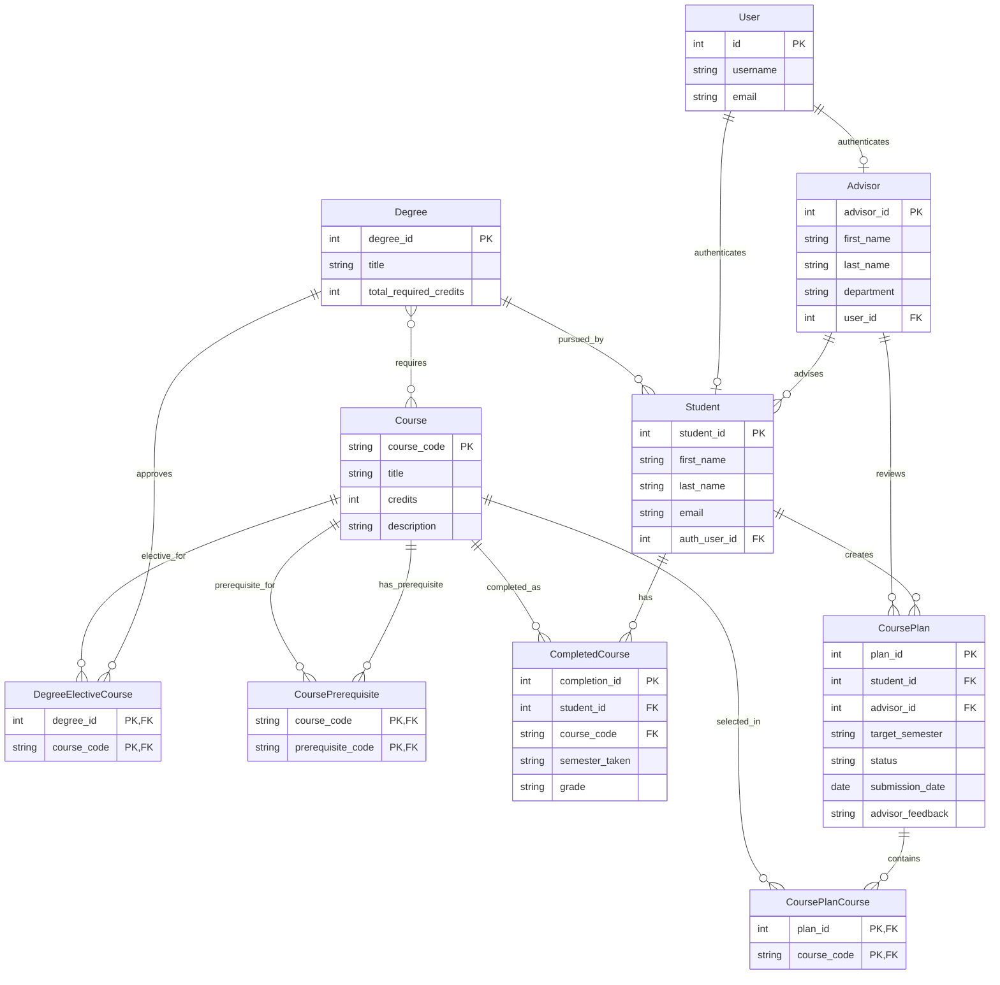

# COMP 3613 Assignment 1

Draft this file with the Guide. **Update it after every phase milestone** before you pause. The use-case diagram is a UML PNG at `docs/diagrams/use-case.png`, linked from this file as `diagrams/use-case.png` (path relative to `docs/report.md`). The model diagram is Mermaid. **Embed wireframe images** as `wireframes/<file>` (files live in `docs/wireframes/`).

Do not put your student ID in this file if you will commit it. The PDF cover adds your name and ID at export time.

## Assigned project

MyAdvisor

## Three workflows

### 1. View Degree Progress (Student)

### 2. Submit Course Plan (Student)

### 3. Review and Approve Plan (Advisor)

## Use case diagram

`Submit Course Plan` includes plan validation; an invalid plan must be corrected
before submission. Student and Advisor share `View Course Plan`. `Review and
Approve Plan` includes viewing the plan, and may extend to `Request Revisions`.
When revisions are requested, the Student can revise the plan and submit it
again through the same validation step.

## Model diagram

The Phase 3 model for students, advising, degree progress, and course planning.

## Wireframes

### View Degree Progress

### Submit Course Plan

### Review and Approve Plan

### Phase 4 review

- The progress screen shows the degree, earned-credit total, and completed and
  remaining course lists. The model diagram represents degree requirements,
  course completion, and the course credits used to calculate those totals.
- The plan screen supports selecting courses, removing selections, prerequisite
  validation, and submission. If validation fails, block submission and show
  unmet prerequisites inline on the editable draft so the student can correct
  it and retry.
- The advisor screen provides a pending-review list, course details, feedback,
  and Approve / Request Edits actions. Show the advisor's feedback in the
  student's returned draft so they can revise and resubmit it.
- Ensure plan and review data identify the relevant semester and clearly show
  the plan's review status.

## Theming

MyAdvisor uses a professional university-portal identity: deep black-plum
surfaces, purple accents, and Inter throughout for a clean, modern type system.
The wordmark and student-portal messaging are consistent across the landing,
login, and registration pages. The authenticated progress view uses the same
purple palette and compact academic dashboard styling.

## Implementation notes

Phase 5 model implementation includes the ERD entities and their foreign-key
relationships, plus join tables for degree requirements, Faculty-approved degree electives,
course prerequisites, and course plans. A Student profile is linked one-to-one
to the existing login account. The
`python manage.py init` seed creates a Bob demo profile with a 96-credit
Computer Science degree, 21 completed courses (63 credits), and 11 remaining
courses.

`View Degree Progress (Student)` is implemented at `/progress` (also available
through `/app`). Its route delegates to a repository-backed service, which
calculates earned credits and returns the completed and remaining required
courses. The progress page displays the degree, credit total, progress bar,
course lists, grades, and semesters; accounts without a linked student profile
receive an explicit empty state.

The UI polish pass aligns login/register fields, styles sign-out as a sidebar
action, and uses local inline SVGs rather than relying on a remote icon font.
The authenticated sidebar remains visible while the page scrolls, and the
course lists use concise section headings.
Estimated time to completion rounds remaining credits up by 15 credits per
semester (five assumed three-credit courses); the sample account shows three
semesters remaining.

`Submit Course Plan (Student)` is implemented at `/course-plan`. The student
selects Semester 1, Semester 2, or Summer Semester and courses in a responsive
catalog/draft split pane. A separate Electives window lists the courses
explicitly approved for the student's degree program.
The route delegates to the course-plan service and repository; the service
checks selected courses against the student's degree, rejects plans with
incomplete prerequisites, and saves the invalid selection as an editable draft
with errors shown beside the affected course. Prerequisites must be completed
before the planned semester; selecting the prerequisite in the same plan does
not satisfy the check. Valid submissions are stored with submitted status and
redirect to degree progress. The demo data includes prerequisite links for the
catalog's chained mobile-app and capstone courses.
The demo program includes Data Science Applications, Cybersecurity
Fundamentals, and Mobile User Experience as Faculty-approved electives.
Students may have up to one submitted or approved plan per target semester
(Semester 1, Semester 2, and Summer Semester); a duplicate submission for the
same semester is blocked with an error toast. The `Your submissions` tab lists
drafts and plans with their statuses. Students can edit saved drafts and
revision-requested plans, delete saved drafts from either the plan builder or
submission history, and withdraw submitted or approved plans. A withdrawn plan
is retained in history, can be edited, and can be resubmitted for its semester.

The focused service test verifies that a missing prerequisite leaves a draft
and blocks submission, then permits that same plan to be submitted once the
prerequisite is recorded as completed. The workflow was also exercised in the
local browser: a CSCI 123 draft showed the inline CSCI 122 blocker, while
submitting CSCI 122 (whose prerequisite CSCI 121 is completed) redirected to
degree progress.

`Review and Approve Plan (Advisor)` is implemented as an advisor-only review
inbox at `/advisor/reviews`. Each Advisor profile is linked to a distinct
advisor login; a plan is visible only to the advisor assigned to its student.
The inbox shows pending submissions, student and degree details, requested
courses, target semester, and submission date. Advisors can approve a plan or
request revisions with required feedback. The student receives that feedback
on the editable plan and may correct and resubmit it through the existing
prerequisite validation workflow. The demo student-profile provisioning path
assigns a student to the advisor with the fewest currently assigned students,
using advisor ID as the stable tie-breaker.

The degree progress page also shows a Current courses window populated from
advisor-approved plans. Approved courses are excluded from remaining
requirements until they are completed, and do not count as earned credits.
The student confirmed satisfaction with the completed web app and its workflow
polish.

## Deployed app

Phase 6. Public Render URL (not localhost). Markers open this to mark the three workflows.

https://

## Logins

Every account a marker needs, including extra users you added. Starter accounts:

- bob / bobpass — regular user
- admin / adminpass — admin
- advisor / advisorpass — advisor
- advisor2 / advisorpass2 — advisor

## YouTube URL

## Session transcripts

Filled when the Guide builds the report: the agent writes each Guide chat to `docs/transcripts/<slug>.md` (Copilot Agent, Cursor, or OpenCode). `python manage.py report` packages them. Do not paste chats here during the build.

## Competency (student-judge)

Filled when the report is built. Guide runs student-judge, writes `docs/judge.md`, and export appends the scorecard here.

## Skill integrity

Filled by `python manage.py report`. Do not edit the course skills.
