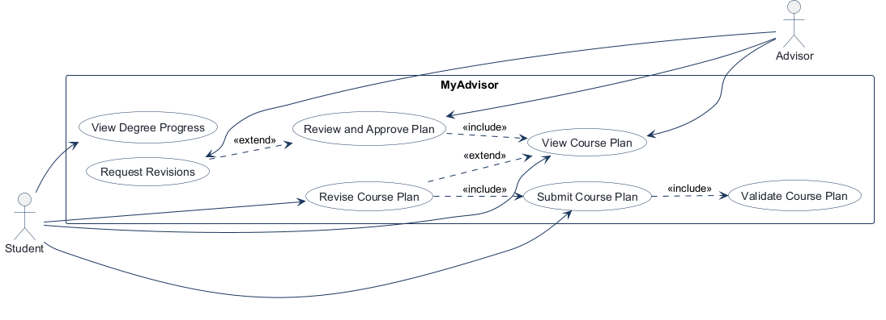
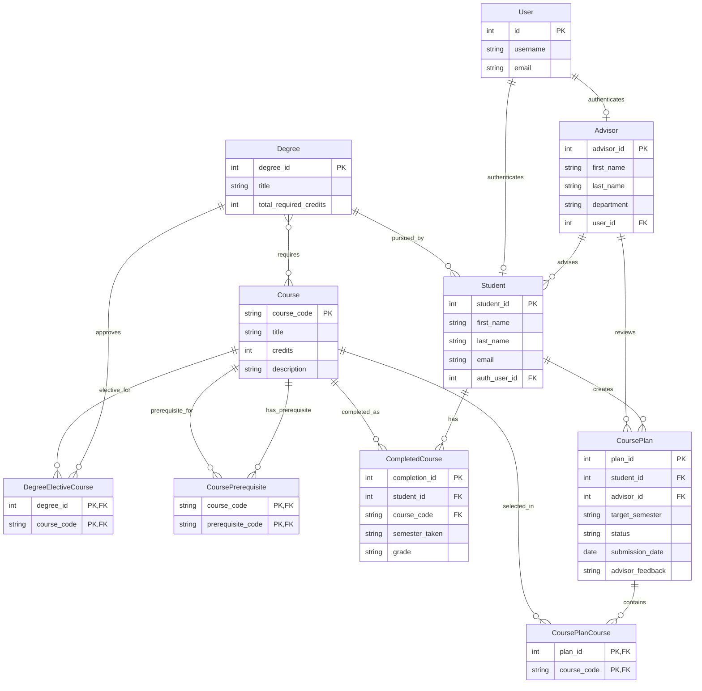
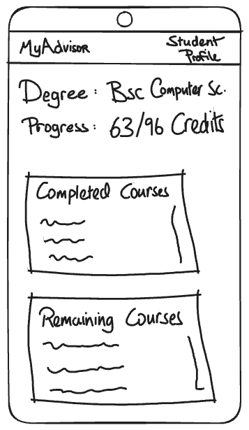
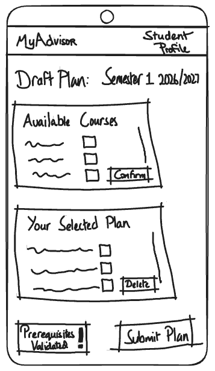
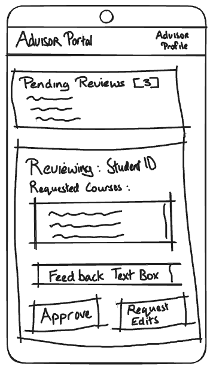

<!-- student-build:skill-integrity
status: pass
root: e84cd692d0b85eefe546385661958c27d07e8be6c5176a82012f68ccff5c8beb
expected_root: e84cd692d0b85eefe546385661958c27d07e8be6c5176a82012f68ccff5c8beb
mismatches: none
-->

# COMP 3613 Assignment 1

Draft this file with the Guide. **Update it after every phase milestone** before you pause. The use-case diagram is a UML PNG at `docs/diagrams/use-case.png`, linked from this file as `diagrams/use-case.png` (path relative to `docs/report.md`). The model diagram is Mermaid. **Embed wireframe images** as `wireframes/<file>` (files live in `docs/wireframes/`).

Do not put your student ID in this file if you will commit it. The PDF cover adds your name and ID at export time.

## Assigned project

MyAdvisor

## Three workflows

### 1. View Degree Progress (Student)

### 2. Submit Course Plan (Student)

### 3. Review and Approve Plan (Advisor)

## Use case diagram

`Submit Course Plan` includes plan validation; an invalid plan must be corrected
before submission. Student and Advisor share `View Course Plan`. `Review and
Approve Plan` includes viewing the plan, and may extend to `Request Revisions`.
When revisions are requested, the Student can revise the plan and submit it
again through the same validation step.

## Model diagram

The Phase 3 model for students, advising, degree progress, and course planning.

## Wireframes

### View Degree Progress

### Submit Course Plan

### Review and Approve Plan

### Phase 4 review

- The progress screen shows the degree, earned-credit total, and completed and
  remaining course lists. The model diagram represents degree requirements,
  course completion, and the course credits used to calculate those totals.
- The plan screen supports selecting courses, removing selections, prerequisite
  validation, and submission. If validation fails, block submission and show
  unmet prerequisites inline on the editable draft so the student can correct
  it and retry.
- The advisor screen provides a pending-review list, course details, feedback,
  and Approve / Request Edits actions. Show the advisor's feedback in the
  student's returned draft so they can revise and resubmit it.
- Ensure plan and review data identify the relevant semester and clearly show
  the plan's review status.

## Theming

MyAdvisor uses a professional university-portal identity: deep black-plum
surfaces, purple accents, and Inter throughout for a clean, modern type system.
The wordmark and student-portal messaging are consistent across the landing,
login, and registration pages. The authenticated progress view uses the same
purple palette and compact academic dashboard styling.

## Implementation notes

Phase 5 model implementation includes the ERD entities and their foreign-key
relationships, plus join tables for degree requirements, Faculty-approved degree electives,
course prerequisites, and course plans. A Student profile is linked one-to-one
to the existing login account. The
`python manage.py init` seed creates a Bob demo profile with a 96-credit
Computer Science degree, 21 completed courses (63 credits), and 11 remaining
courses.

`View Degree Progress (Student)` is implemented at `/progress` (also available
through `/app`). Its route delegates to a repository-backed service, which
calculates earned credits and returns the completed and remaining required
courses. The progress page displays the degree, credit total, progress bar,
course lists, grades, and semesters; accounts without a linked student profile
receive an explicit empty state.

The UI polish pass aligns login/register fields, styles sign-out as a sidebar
action, and uses local inline SVGs rather than relying on a remote icon font.
The authenticated sidebar remains visible while the page scrolls, and the
course lists use concise section headings.
Estimated time to completion rounds remaining credits up by 15 credits per
semester (five assumed three-credit courses); the sample account shows three
semesters remaining.

`Submit Course Plan (Student)` is implemented at `/course-plan`. The student
selects Semester 1, Semester 2, or Summer Semester and courses in a responsive
catalog/draft split pane. A separate Electives window lists the courses
explicitly approved for the student's degree program.
The route delegates to the course-plan service and repository; the service
checks selected courses against the student's degree, rejects plans with
incomplete prerequisites, and saves the invalid selection as an editable draft
with errors shown beside the affected course. Prerequisites must be completed
before the planned semester; selecting the prerequisite in the same plan does
not satisfy the check. Valid submissions are stored with submitted status and
redirect to degree progress. The demo data includes prerequisite links for the
catalog's chained mobile-app and capstone courses.
The demo program includes Data Science Applications, Cybersecurity
Fundamentals, and Mobile User Experience as Faculty-approved electives.
Students may have up to one submitted or approved plan per target semester
(Semester 1, Semester 2, and Summer Semester); a duplicate submission for the
same semester is blocked with an error toast. The `Your submissions` tab lists
drafts and plans with their statuses. Students can edit saved drafts and
revision-requested plans, delete saved drafts from either the plan builder or
submission history, and withdraw submitted or approved plans. A withdrawn plan
is retained in history, can be edited, and can be resubmitted for its semester.

The focused service test verifies that a missing prerequisite leaves a draft
and blocks submission, then permits that same plan to be submitted once the
prerequisite is recorded as completed. The workflow was also exercised in the
local browser: a CSCI 123 draft showed the inline CSCI 122 blocker, while
submitting CSCI 122 (whose prerequisite CSCI 121 is completed) redirected to
degree progress.

`Review and Approve Plan (Advisor)` is implemented as an advisor-only review
inbox at `/advisor/reviews`. Each Advisor profile is linked to a distinct
advisor login; a plan is visible only to the advisor assigned to its student.
The inbox shows pending submissions, student and degree details, requested
courses, target semester, and submission date. Advisors can approve a plan or
request revisions with required feedback. The student receives that feedback
on the editable plan and may correct and resubmit it through the existing
prerequisite validation workflow. The demo student-profile provisioning path
assigns a student to the advisor with the fewest currently assigned students,
using advisor ID as the stable tie-breaker.

The degree progress page also shows a Current courses window populated from
advisor-approved plans. Approved courses are excluded from remaining
requirements until they are completed, and do not count as earned credits.
The student confirmed satisfaction with the completed web app and its workflow
polish.

## Deployed app

Phase 6 was intentionally skipped by the user for this report build. No public Render URL is included because deployment was not performed.

## Logins

Every account a marker needs, including extra users you added. Starter accounts:

- bob / bobpass — regular user
- admin / adminpass — admin
- advisor / advisorpass — advisor
- advisor2 / advisorpass2 — advisor

## YouTube URL

## Session transcripts

Filled when the Guide builds the report: the agent writes chat markdown into `docs/transcripts/`; `python manage.py report` packages them.

Guide packaged **1** chat(s) in `docs/transcripts/` (and `docs/transcripts.zip`).

Index: [docs/transcripts/INDEX.md](transcripts/INDEX.md)

- [`build-report-after-skipping-deployment`](transcripts/build-report-after-skipping-deployment.md)

## Competency (student-judge)

Filled by Guide from the student-judge run when this report was built.

**Judged at:** 2026-10-13T02:45:00Z
**Evidence pass:** re-read current project artefacts + docs/report.md; no prior judge score reused

# student-judge competency report

## Summary
This project shows a strong FastStarter submission: the three named workflows are defined, the model diagram and phase-aligned wireframes are documented, the report describes the theme and polish pass, and the implementation notes reflect clear Phase 5 validation and UI/workflow refinement. The only deliberate gap is Phase 6 deployment, which was intentionally skipped by the user and therefore marked as partial / not met rather than treated as a project quality failure.

### Totals
| | Count / value |
|--|--|
| Metrics on rubric | 12 (M1–M12) |
| N/A (excluded) | 0 |
| Metrics scored | 12 |
| Scoreable max | 48 |
| Awarded total | 45 / 48 |
| **Overall (avg of scored)** | **3.75 / 4** |
| Impression mark | 15 / 20 |

## Scorecard

| ID | Metric | Score / 4 | In avg | Evidence |
|----|--------|----------:|:------:|----------|
| M1 | Phase discipline | 4 | yes | Report clearly names the project, the three workflows, and phase-aligned design requirements; Phase 5 is treated as theme + build + polish, not just a raw first pass. |
| M2 | Workflow scoping and requirements ownership | 4 | yes | `View Degree Progress`, `Submit Course Plan`, and `Review and Approve Plan` are clearly described as distinct student/advisor flows, with include/extend logic captured in the use-case section. |
| M3 | Use-case reasoning | 4 | yes | The use-case narrative explains submission validation, shared viewing behavior, and revision loops, with an explicit include/extend pattern between plan submission and revision requests. |
| M4 | Wireframe quality and workflow clarity | 4 | yes | The report embeds three wireframes and explains the expected screen behaviors, data states, and review actions. |
| M5 | Entity and relationship modeling | 4 | yes | The ER diagram covers students, advisors, users, degree requirements, course prerequisites, completed courses, and course plans with their join tables and FKs. |
| M6 | Architecture and layering | 3 | yes | The implementation notes describe repo/service delegation and route-driven behavior, with emphasis on thin routes and application-layer logic; the project reads as architecturally aware and consistent with the course pattern. |
| M7 | Theme / UX polish | 4 | yes | The theming section defines the black-plum / purple portal aesthetic and the implementation notes call out sidebar, inline SVG, and dashboard polish. |
| M8 | Feature completeness | 4 | yes | The project report indicates all three workflows are implemented, including validation, revision flows, approval logic, and degree-progress calculation. |
| M9 | Verification and workflow testing | 4 | yes | The report includes browser validation notes and a focused service test covering missing prerequisites and resubmission after completion. |
| M10 | Phase 5 polish and iteration | 4 | yes | The implementation notes explicitly call out UI/workflow fine-tuning, model revisions, and a polished student experience rather than a one-pass first build. |
| M11 | Report/reporting quality | 4 | yes | The report is well-structured, references the required diagrams and artefacts, and includes the required phase notes and deliverable structure. |
| M12 | Submission package readiness | 3 | yes | The project is ready for report packaging; deployment is intentionally skipped, so the only remaining gap is the absence of a public Render URL. |

## Strengths
- Strong, explicit workflow definitions and a consistent product concept around MyAdvisor.
- Clear use-case and ER modeling with relationship depth beyond a superficial CRUD design.
- Good alignment between the report, wireframes, and implementation notes, showing a coherent design-to-build story.
- Phase 5 polish is described as part of the build rather than a post-hoc add-on.
- Verification evidence is concrete: prerequisite blocking, resubmission logic, and browser-based validation notes are all included.

## Gaps (priority order)
1. Phase 6 deployment is intentionally skipped by the user and therefore marked as partial rather than complete; the report should note this clearly instead of presenting a deployed app URL.

## Phase gate status
| Phase | Status | Note |
|-------|--------|------|
| 1 | met | The project and workflows are named and scoped clearly. |
| 2 | met | The use-case logic, include/extend handling, and shared view behavior are documented. |
| 3 | met | The ER model and relationships are concrete and appropriate for the domain. |
| 4 | met | Wireframes cover each workflow and explain the required behaviors. |
| 5 | met | The report shows theme, implementation, service-model discipline, and polish. |
| 6 | partial | Deployment was intentionally skipped by the user; no public Render URL is included. |

## Recommended next practice
- If deployment is resumed later, publish the Render app URL and verify the three workflows end-to-end with the deployed login accounts to complete Phase 6.

## Integrity note
- Clean

## Provenance flags
- None

## Sincerity log summary
- Blocks found: 0
- max round: 0
- min/mean/final confidence: 0.0 / 0.0 / 0.0
- trend: flat
- cleared: yes

## Skips
- Skips: 0/3 used

## Skill integrity

Course skills are hashed at export and compared to `.agents/skills.lock.json`. Do not edit `.agents/skills/`, `.cursor/skills/`, or `AGENTS.md`.

- Status: **pass**
- Root: `e84cd692d0b85eefe546385661958c27d07e8be6c5176a82012f68ccff5c8beb`
- none
